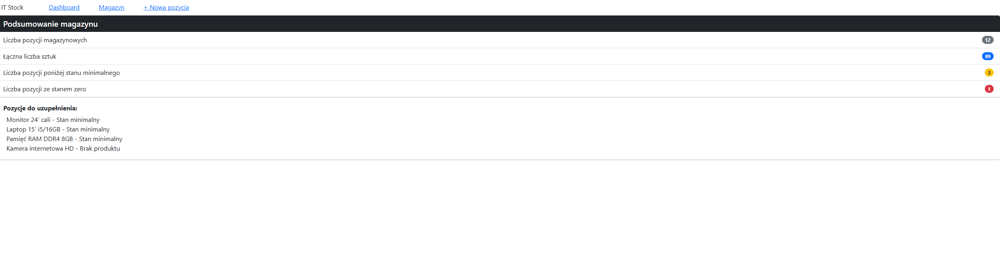
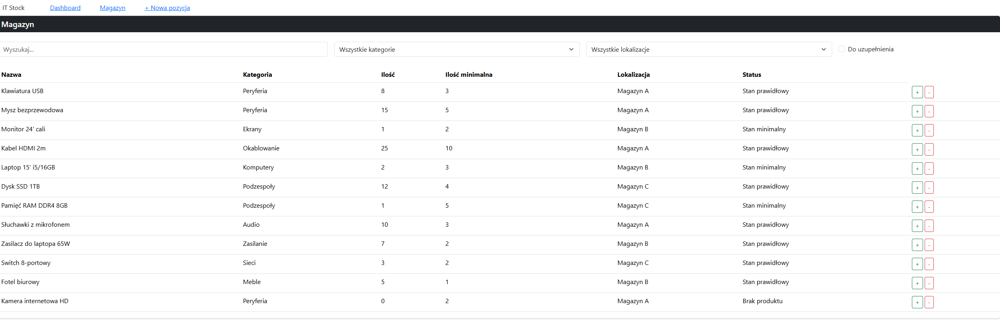
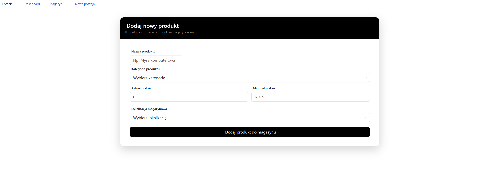
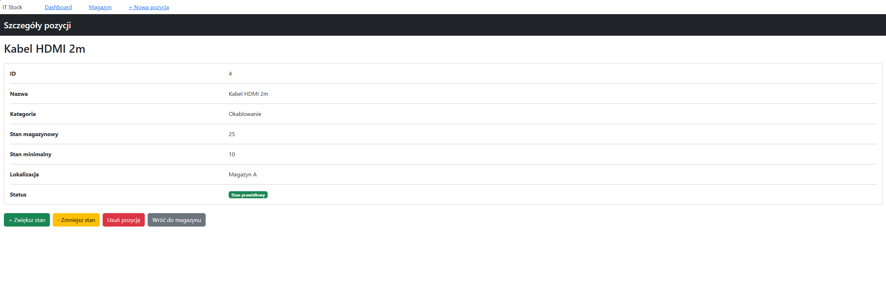

# Projekt grupowy aplikacji webowej - magazyn sprzętu

## Funkcjonalności

- Widok tabeli zawierającej wszystkie produkty w magazynie
- Widok szczegółów danego produktu
- Formularz dodania nowego produktu
- Możliwość zwiększania i zmniejszania ilości produktów w magazynie oraz ich usuwanie

## Technologie

- Bootstrap 5
- React + Vite
- React Router

## Routing

| Route | Component | Description |
|:------|:----------|:------------|
| `/` | `DashboardPage` | Podsumowanie magazynu |
| `/inventory` | `InventoryPage` | Widok wszystkich produktów
| `/inventory/new` | `NewItemPage` | Dodawanie nowego produktu
| `/inventory/:id` | `ItemDetailsPage` | Szczegóły danego produktu

## Widoki aplikacji

### Dashboard

### Magazyn

### Nowy produkt

### Szczegóły produktu

